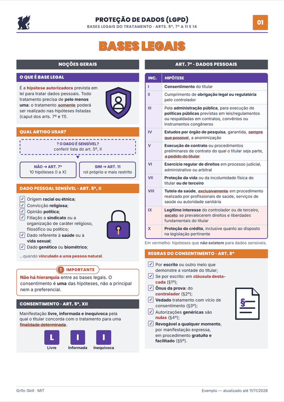

<p align="center">
  
</p>

<h1 align="center">Grifo-Skill: illustrated study guides on any subject, made with AI</h1>

<p align="center">
  <b>Open-source (MIT) skill for Claude and Codex that turns a topic — or your PDF, slides
  or notes — into university-level A4 study material: structured summary, concept map,
  night-before review, original practice questions with an explained answer key, and
  flashcards.</b>
</p>

<p align="center"><a href="README.md">Português</a> · <b>English</b></p>

<p align="center">
  
</p>

## What it does

Tell it the subject (or attach a file) and the format. It researches reliable sources,
lays out A4 pages with **editorial design** and **labeled figures drawn from scratch**
(heart in cross-section, cell, chloroplast, circuits…), and delivers **HTML and PDF**.
The material is written **in your language**: ask in English, get English — labels,
dates, hyphenation and question format included.

Before delivery, **three reviewers** check the material cold:

| Reviewer | Checks |
|---|---|
| 🔎 **Content validator** | every figure, date, formula and answer against the source |
| 🎓 **Didactic reviewer** | precise definition, mechanism, example, common mistake |
| 🎨 **Design critic** | layout, hierarchy, colors and figures on the rendered pages |

## How to use

Ask in your own words — if the subject or format is missing, the skill **asks first**:

> **You:** make a study guide from this pharmacology PDF
> **Grifo:** Which format? *Full explanation* · *Map only* · *Quick review* · *Practice (questions/flashcards)* · *Everything*
> And which style? *Sober* · *Colorful* · *Pastel* · *Black & white*

Commands work in any language (`/resumo` = summary, `/esquema` = map, `/revisao` = review,
`/questoes` = questions, `/flashcards`, `/comparar` = compare, `/apostila` = full guide;
`/grifo` shows help). Common flags:

```
--formato completo|mapa|revisao|treino|tudo   --estilo sobrio|colorido|pastel|pb
--nivel medio|faculdade|concurso|certificacao --folhas N   --material file   --idioma en
```

### Color styles

| Style | Looks like |
|---|---|
| **Sober** (default) | navy and gray; color only where it means something |
| **Colorful** | each column and block in its own hue (blue, teal, purple, wine, indigo, graphite) |
| **Pastel** | the same hues in soft tones, light backgrounds |
| **B&W** | grayscale, for black-and-white printing |

Red, green and amber stay reserved for errors, correct answers and exceptions in every style.

## Install

**Claude Code (plugin):**
```
/plugin marketplace add asguth/grifo-skill
/plugin install grifo-skill@grifo-skill
```

**Claude.ai / Claude app:** download `grifo-skill.zip` from
[Releases](https://github.com/asguth/grifo-skill/releases/latest) and upload it under
**Settings → Capabilities → Skills**.

**Codex:** `cp -r grifo-skill/skills/grifo ~/.codex/skills/grifo`

PDF/PNG output needs Python + Playwright (or Chrome); without them you get the HTML to print
from the browser (Ctrl+P → A4, no margins, background graphics).

## Examples

| Material | Area | Pages | PDF |
|---|---|---|---|
| Photosynthesis · **pastel**, in English | Biology | 1 | [PDF](exemplos/en-photosynthesis.pdf) · [preview](docs/exemplos/en-photosynthesis-p1.png) |
| The heart: anatomy and cardiac cycle · **colorful** (Portuguese) | Medicine | 4 | [PDF](exemplos/medicina-coracao.pdf) · [preview](docs/exemplos/medicina-coracao-p1.png) |
| Other examples (Portuguese: grammar, logic, Brazilian law) | — | 4–5 | see the [Portuguese README](README.md#exemplos) |

## Rules the skill follows

- **Accuracy over looks:** every fact comes from a checked source; anything unchecked is
  marked `[VERIFY]`. References link to the official source of your country.
- **No copying:** no third-party text, figures, images or exam questions.
- **No portraits of real people.** **Readable in black and white.**

> ⚠️ AI-generated material can contain errors even after review. Check the sources.

## License

[MIT](LICENSE) © 2026 Alberto Guth (GT Design). Inter and Poppins fonts:
[SIL OFL](skills/grifo/assets/fontes/OFL.txt). Lucide icons: ISC.
