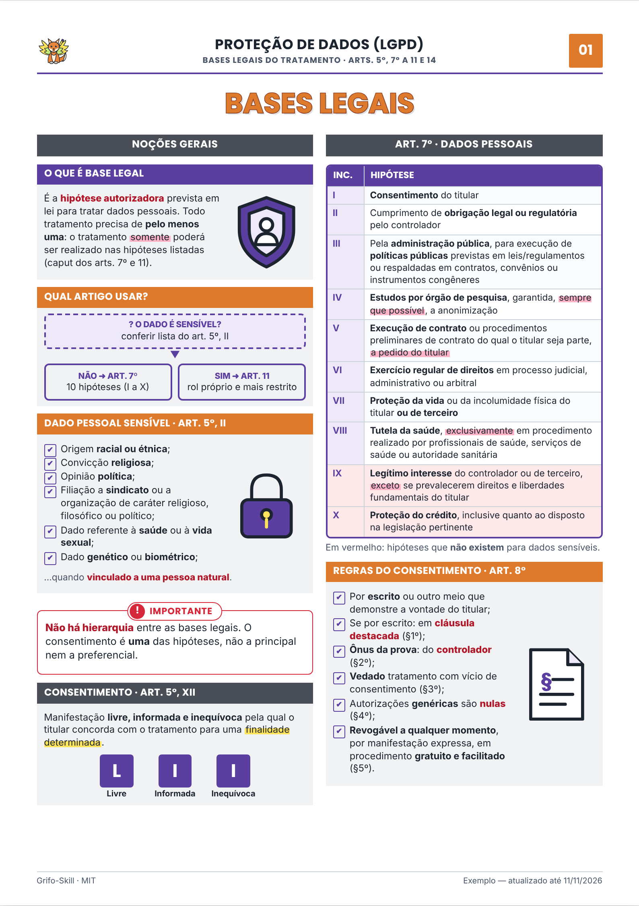

# Grifo-Skill

**Skill de IA que monta resumos e apostilas ilustradas para concursos públicos** no
padrão das apostilas esquematizadas: folha A4, duas colunas, faixas coloridas,
personagens e ícones ilustrados, fluxogramas, tabelas comparativas, lei seca grifada
e questões no estilo da banca.

Todo material passa por **três revisores automáticos** antes de chegar até você:

| Revisor | O que confere |
|---|---|
| 🔎 **Validador de conteúdo** | Cada artigo, prazo, número e gabarito contra a fonte oficial |
| 🎓 **Revisor didático** | Se dá para entender sozinho, se cobre o que cai e se a ordem faz sentido |
| 🎨 **Crítico de design** | Olha a página renderizada: layout, hierarquia, cores e ilustrações |

Gratuito e open source (MIT).



## Comandos

| Comando | O que gera |
|---|---|
| `/resumo <tópico> [banca] [cargo]` | Resumo ilustrado completo (1–4 folhas) |
| `/esquema <tópico>` | Uma folha de mapa visual do tópico |
| `/lei-seca <lei> [artigos]` | Lei seca com grifos (o que decorar × o que a banca troca) |
| `/comparar <A> vs <B>` | Tabela comparativa + como a banca confunde |
| `/pegadinhas <tópico> [banca]` | Armadilhas típicas da banca, com correção e fundamento |
| `/questoes <tópico> [banca] [n]` | Questões **inéditas** no estilo da banca + gabarito comentado |
| `/flashcards <tópico>` | Cartões frente/verso para recortar |
| `/mnemonico <lista>` | Mnemônicos visuais |
| `/edital <edital>` | Edital verticalizado com checklist e prioridades |
| `/cronograma <matérias> <h/semana> <data>` | Plano semanal com revisões espaçadas |
| `/revisao <tópico>` | Folha única de revisão de véspera |
| `/apostila <disciplina>` | Apostila completa: capa, sumário, resumos e questões |
| `/validar <arquivo.html>` | Roda os 3 revisores num material existente |

Funciona também em linguagem natural: *"faz um resumo de atos administrativos pra FGV"*.

**Bancas:** Cebraspe, FGV, FCC, Vunesp, Cesgranrio, IBFC, Quadrix ou **indefinida**
(o padrão). Com banca indefinida, as questões saem nos dois formatos (certo/errado e A–E).

**Material próprio:** anexe sua apostila, PDF ou anotações e ela vira a fonte principal.

## Instalação

### Claude Code (plugin, com os slash commands)
```
/plugin marketplace add asguth/grifo-skill
/plugin install grifo-skill@grifo-skill
```

### Claude.ai / app Claude (skill)
1. Baixe `grifo-skill.zip` na página de *Releases* (ou compacte a pasta `skills/grifo`).
2. No Claude, vá até a área de **Skills** nas configurações e faça upload do zip.
3. Peça: *"/resumo controle de constitucionalidade, banca FGV"*.

> Para gerar o PDF e as imagens de revisão, o ambiente precisa de execução de código
> (Python + Playwright ou Chrome). Sem isso, a skill entrega o HTML, que você imprime
> pelo navegador (Ctrl+P → A4, sem margens, com gráficos de fundo).

### Outros modelos
`skills/grifo/SKILL.md` + `references/` funcionam como prompt de sistema em
qualquer LLM com execução de código. Os revisores ficam em `skills/grifo/agentes/`.

## Como funciona

```
pedido ─▶ fontes oficiais ─▶ roteiro didático ─▶ HTML (design system) ─▶ montar.py
      ─▶ renderizar.py (PDF + PNG) ─▶ 3 revisores em paralelo ─▶ correções ─▶ entrega
```

- **Design system "Grifo"** (`assets/apostila.css`): cores por disciplina e cores
  **semânticas fixas** (vermelho = pegadinha, laranja = exceção/dica, verde = macete,
  cinza = lei seca). O aluno aprende o código uma vez e lê qualquer matéria.
- **Biblioteca de ilustrações** (`assets/ilustracoes.svg`): 34 ilustrações flat
  próprias (juiz, autor, servidora, balança, cadeado, Constituição, Congresso e o
  mascote **Grifo**) que mudam de cor com a disciplina. A skill também desenha
  ilustrações novas no mesmo estilo.
- **`montar.py`** injeta o CSS e só as ilustrações usadas → um HTML único e autocontido.
- **`renderizar.py`** gera PDF A4 + PNG por folha e acusa estouro de página.

### Exemplos prontos
| Material | Folhas | PDF |
|---|---|---|
| LGPD — bases legais | 3 | [exemplos/lgpd-bases-legais.pdf](exemplos/lgpd-bases-legais.pdf) |
| Lei 9.784/99 — processo administrativo federal | 3 | [exemplos/lei-9784-processo-administrativo.pdf](exemplos/lei-9784-processo-administrativo.pdf) |
| Lei 8.112/90 — servidores públicos federais | 4 | [exemplos/lei-8112-servidores.pdf](exemplos/lei-8112-servidores.pdf) |


## Regras que a skill segue

- **Fidelidade acima de estética:** todo artigo, prazo e número vem da fonte oficial.
  O que não for conferido aparece marcado como `[VERIFICAR]`.
- **Sem cópia:** não reproduz texto, esquemas ou imagens de cursinhos, livros ou
  apostilas de terceiros, nem questões reais de prova. Lei e atos oficiais podem
  ser citados literalmente (Lei 9.610/98, art. 8º, IV).
- **Sem fotos de terceiros nem retratos de pessoas reais:** todas as ilustrações são próprias.
- **Legível em preto e branco:** todo bloco tem ícone e rótulo, não só cor.

> ⚠️ Material gerado por IA pode conter erros, mesmo depois da validação. Confira
> sempre a lei seca vigente antes da prova.

## Estrutura

```
.claude-plugin/        manifest do plugin e marketplace (Claude Code)
commands/              slash commands (/resumo, /questoes, …)
skills/grifo/
  SKILL.md             fluxo principal
  references/          comandos, componentes, design, bancas, fidelidade
  agentes/             validador de conteúdo, revisor didático, crítico de design
  assets/              apostila.css (design system) e ilustracoes.svg
  scripts/             montar.py e renderizar.py
exemplos/              LGPD (bases legais), Lei 9.784/99, Lei 8.112/90 — fonte, HTML e PDF — e galeria
docs/                  imagens do README
```

## Contribuindo

PRs são bem-vindos, principalmente para:
- **novas ilustrações** no estilo da biblioteca (regras em `references/design.md` §4);
- **perfis de banca** mais precisos (`references/bancas.md`);
- **exemplos** de resumos revisados por quem passou na prova.

Antes de mandar: rode `montar.py` e `renderizar.py` no seu exemplo e anexe o PNG ao PR.

## Licença

[MIT](LICENSE). Use, modifique e distribua à vontade, inclusive para fins comerciais,
mantendo o aviso de copyright.
