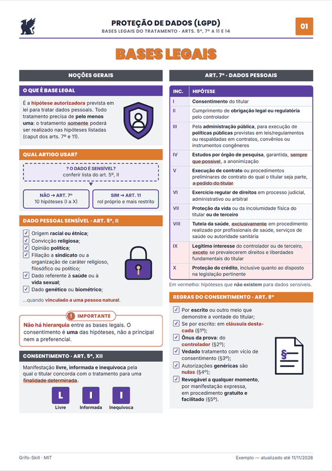
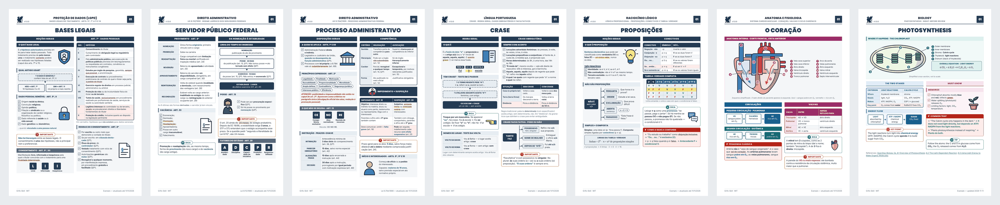
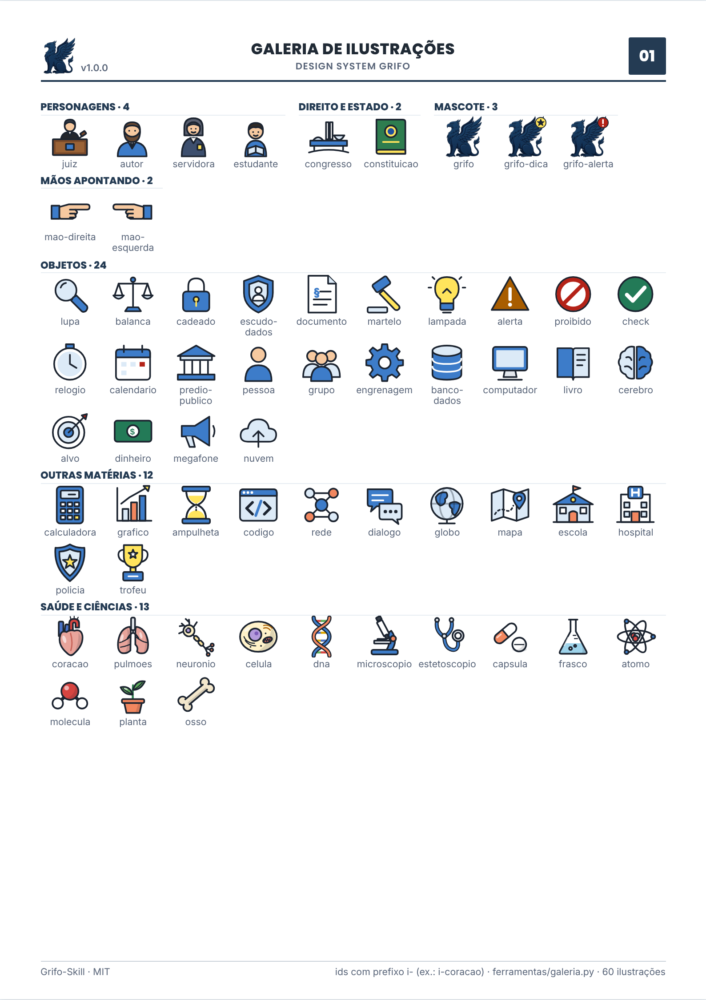
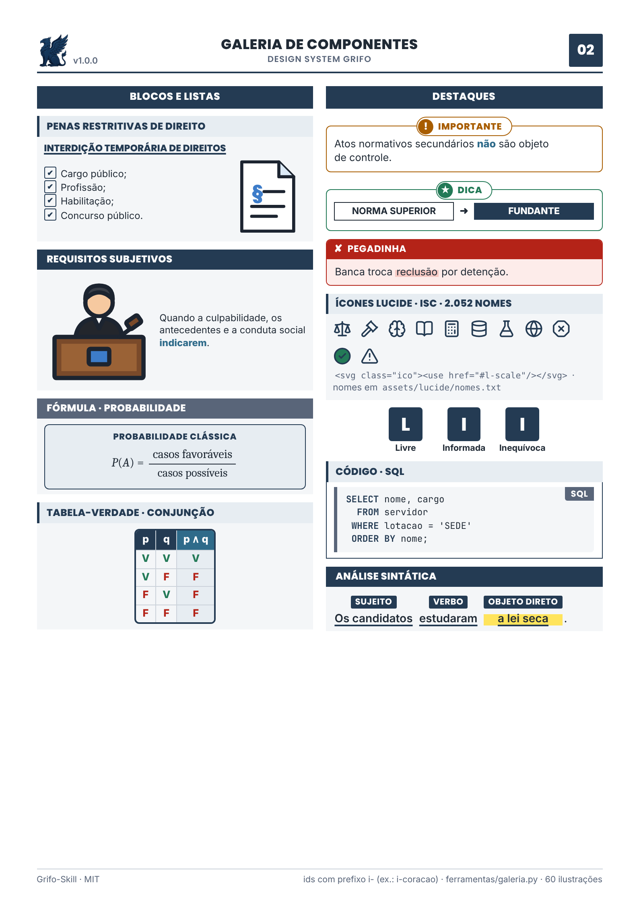

<p align="center">
  
  <a href="https://github.com/asguth/grifo-skill/releases/latest"></a>
</p>

<h1 align="center">Grifo-Skill: apostilas e resumos ilustrados de qualquer assunto, feitos com IA</h1>

<p align="center">
  <b>Skill open source (MIT) para Claude e Codex que transforma um tema — ou o seu PDF, slides
  ou anotações — em material de estudo A4 nível universitário: resumo esquematizado, mapa,
  revisão, questões inéditas com gabarito comentado e flashcards.</b>
</p>

<p align="center">
  <a href="LICENSE"></a>
  <a href="https://github.com/asguth/grifo-skill/actions/workflows/ci.yml"></a>
  
  
  
  <a href="https://buymeacoffee.com/asguth"></a>
</p>

<p align="center"><b>Português</b> · <a href="README.en.md">English</a></p>

<p align="center">
  
</p>

<p align="center">
  <a href="#instalação">Instalação</a> ·
  <a href="#como-usar">Como usar</a> ·
  <a href="#exemplos">Exemplos</a> ·
  <a href="#galeria">Galeria</a> ·
  <a href="#como-funciona">Como funciona</a> ·
  <a href="#perguntas-frequentes">FAQ</a> ·
  <a href="#apoie-o-projeto">Apoie</a>
</p>

---

## O que é

O **Grifo-Skill** gera **apostilas ilustradas** sobre o que você estiver estudando —
Bioquímica, Cálculo, Direito, Português, Programação, Contabilidade, uma disciplina da
faculdade ou um edital de concurso. Você diz o assunto (ou anexa o arquivo) e o formato;
ele pesquisa em fontes confiáveis, monta folhas A4 com **design editorial** (hierarquia
clara, cor só onde carrega significado, legível impresso em preto e branco) e entrega
**HTML e PDF**.

Antes da entrega, **três revisores** olham o material a frio:

| Revisor | O que confere |
|---|---|
| 🔎 **Validador de conteúdo** | Cada dado, data, fórmula, artigo e gabarito contra a fonte |
| 🎓 **Revisor didático** | Nível superior: definição precisa, mecanismo, exemplo, erro comum |
| 🎨 **Crítico de design** | Layout, hierarquia, cores e ilustrações nas páginas renderizadas |

## Como usar

Peça do seu jeito — se faltar o assunto ou o formato, a skill **pergunta antes de começar**:

> **Você:** faz uma apostila desse PDF de farmacologia
> **Grifo:** Qual formato? *Explicação completa* · *Só o mapa* · *Revisão rápida* · *Treino (questões/flashcards)* · *Tudo incluso*
> E qual estilo? *Sóbrio* · *Colorido* · *Pastel* · *P&B*

Ou vá direto ao comando:

| Comando | O que gera | Exemplo |
|---|---|---|
| `/resumo` | Explicação completa, 1–4 folhas + questões + gabarito | `/resumo ciclo de Krebs --nivel faculdade` |
| `/esquema` | Uma folha de mapa visual | `/esquema tipos de memória RAM` |
| `/revisao` | Uma folha de revisão de véspera | `/revisao derivadas` |
| `/questoes` | Questões **inéditas** + gabarito comentado em folha separada | `/questoes LGPD --nivel concurso --banca cebraspe` |
| `/flashcards` | Cartões frente/verso para recortar (8 por folha) | `/flashcards anatomia do coração` |
| `/comparar` | Tabela A × B + confusões comuns | `/comparar mitose vs meiose` |
| `/mnemonico` | Siglas e frases para decorar | `/mnemonico camadas do modelo OSI` |
| `/apostila` | Tudo incluso: capa, sumário, resumos, mapa, questões | `/apostila microeconomia --material notas.pdf` |
| `/lei-seca` · `/pegadinhas` · `/edital` · `/cronograma` | Para concursos | `/lei-seca Lei 9.784/1999 --artigos 53-55` |
| `/validar` | Roda os 3 revisores num HTML existente | `/validar minha-apostila.html` |
| `/grifo` | Ajuda com todos os comandos e flags | `/grifo questoes` |

Flags comuns: `--formato completo|mapa|revisao|treino|tudo` · `--estilo sobrio|colorido|pastel|pb`
· `--nivel medio|faculdade|concurso|certificacao` · `--folhas N` · `--material arquivo`
· `--idioma en|es|fr|it|de…` · `--banca` (concursos).

### Estilos de cor

Tem gente que memoriza melhor com cor em cada tópico; tem gente que prefere a página calma.

| Estilo | Como fica |
|---|---|
| **Sóbrio** (padrão) | azul-marinho e cinza; cor só onde tem significado |
| **Colorido** | cada coluna e cada bloco num matiz diferente (azul, petróleo, roxo, vinho, índigo, grafite) |
| **Pastel** | os mesmos matizes em tons suaves, fundos claros |
| **P&B** | tons de cinza, para imprimir em preto e branco |

Vermelho, verde e âmbar continuam reservados a erro, acerto e exceção em qualquer estilo.

### Outros idiomas

A skill escreve o material na língua de quem pede — *"make a cheat sheet on the cardiac
cycle"* sai em inglês, *"hazme un resumen de fotosíntesis"* sai em espanhol — com rótulos,
datas, hifenização e formato de questões do país. Ver
[`references/idiomas.md`](skills/grifo/references/idiomas.md). Detalhes em
[`references/comandos.md`](skills/grifo/references/comandos.md).

## Instalação

### Claude Code (plugin, com os slash commands)
```
/plugin marketplace add asguth/grifo-skill
/plugin install grifo-skill@grifo-skill
```
Digite `/grifo` para ver os comandos. Conflito de nome com outro plugin? Use
`/grifo-skill:resumo`.

### Claude.ai / app Claude
1. Baixe **`grifo-skill.zip`** em [Releases](https://github.com/asguth/grifo-skill/releases/latest).
2. Em **Configurações → Capacidades → Skills**, faça upload do zip.
3. Peça: *"faz um resumo de termodinâmica"* ou anexe um arquivo.

### Codex (OpenAI)
Copie a pasta da skill para o diretório de skills do Codex:
```bash
git clone https://github.com/asguth/grifo-skill
cp -r grifo-skill/skills/grifo ~/.codex/skills/grifo
```
No Codex, peça normalmente (*"apostila de estatística, só o mapa"*) ou escreva o comando
no texto (*"/questoes LGPD"*). Dentro deste repositório, o [`AGENTS.md`](AGENTS.md) já
aponta o Codex para a skill.

> Para gerar PDF e imagens, o ambiente precisa de Python + Playwright (ou Chrome). Sem
> isso, a skill entrega o HTML, que você imprime pelo navegador (Ctrl+P → A4, sem margens,
> gráficos de fundo).

## Exemplos

<p align="center">
  
</p>

| Material | Área | Folhas | PDF | Prévia |
|---|---|---|---|---|
| Crase | Língua Portuguesa | 4 | [PDF](exemplos/portugues-crase.pdf) | [1](docs/exemplos/portugues-crase-p1.png) · [2](docs/exemplos/portugues-crase-p2.png) · [3](docs/exemplos/portugues-crase-p3.png) · [4](docs/exemplos/portugues-crase-p4.png) |
| Proposições e tabela-verdade | Lógica | 4 | [PDF](exemplos/rlm-proposicoes.pdf) | [1](docs/exemplos/rlm-proposicoes-p1.png) · [2](docs/exemplos/rlm-proposicoes-p2.png) · [3](docs/exemplos/rlm-proposicoes-p3.png) · [4](docs/exemplos/rlm-proposicoes-p4.png) |
| LGPD — bases legais | Proteção de dados | 4 | [PDF](exemplos/lgpd-bases-legais.pdf) | [1](docs/exemplos/lgpd-bases-legais-p1.png) · [2](docs/exemplos/lgpd-bases-legais-p2.png) · [3](docs/exemplos/lgpd-bases-legais-p3.png) · [4](docs/exemplos/lgpd-bases-legais-p4.png) |
| Lei 8.112/90 — servidores federais | Direito Administrativo | 5 | [PDF](exemplos/lei-8112-servidores.pdf) | [1](docs/exemplos/lei-8112-servidores-p1.png) · [2](docs/exemplos/lei-8112-servidores-p2.png) · [3](docs/exemplos/lei-8112-servidores-p3.png) · [4](docs/exemplos/lei-8112-servidores-p4.png) · [5](docs/exemplos/lei-8112-servidores-p5.png) |
| Lei 9.784/99 — processo administrativo | Direito Administrativo | 4 | [PDF](exemplos/lei-9784-processo-administrativo.pdf) | [1](docs/exemplos/lei-9784-processo-administrativo-p1.png) · [2](docs/exemplos/lei-9784-processo-administrativo-p2.png) · [3](docs/exemplos/lei-9784-processo-administrativo-p3.png) · [4](docs/exemplos/lei-9784-processo-administrativo-p4.png) |
| Coração: anatomia e ciclo cardíaco · estilo **colorido** | Medicina / Fisiologia | 4 | [PDF](exemplos/medicina-coracao.pdf) | [1](docs/exemplos/medicina-coracao-p1.png) · [2](docs/exemplos/medicina-coracao-p2.png) · [3](docs/exemplos/medicina-coracao-p3.png) · [4](docs/exemplos/medicina-coracao-p4.png) |
| Photosynthesis (em inglês) · estilo **pastel** | Biology | 1 | [PDF](exemplos/en-photosynthesis.pdf) | [1](docs/exemplos/en-photosynthesis-p1.png) |

Os dois últimos mostram **figuras desenhadas do zero** (coração em corte com 12 estruturas
numeradas, sistema de condução, cloroplasto): quando o assunto tem estrutura física, a
skill desenha a figura rotulada em vez de pôr um ícone ao lado do texto
([`references/ilustracoes.md`](skills/grifo/references/ilustracoes.md)).

Em todos: questões em coluna única e o **gabarito comentado + referências com link** numa
folha separada, para não dar spoiler.

## Galeria

**60 ilustrações próprias e coloridas** (com o mascote Grifo e um conjunto de saúde e
ciências com volume) e **2.052 ícones [Lucide](https://lucide.dev)** por nome. Para
anatomia, célula, aparelhos e circuitos, a skill desenha **figuras rotuladas do zero**:



<details>
<summary><b>Componentes do design system</b> (blocos, destaques, fórmula, tabela-verdade, código, análise sintática, ícones)</summary>


</details>

## Como funciona

```
pedido ─▶ (pergunta assunto/formato, se faltar) ─▶ fontes ─▶ roteiro didático
       ─▶ template + HTML ─▶ verificar.py ─▶ montar.py ─▶ renderizar.py (PDF + PNG + relatório)
       ─▶ 3 revisores ─▶ correções ─▶ entrega
```

- **Design editorial** (`assets/grifo.css`): navy e blue para estrutura e apoio; âmbar,
  vermelho e verde só para exceção, erro e acerto; slate para referências; estilos
  `colorido`, `pastel` e `pb` por `data-tema`. Contraste ≥ 4,5:1 conferido por script
  em todos os estilos; todo destaque tem ícone e rótulo.
- **`montar.py`**: HTML único e autocontido, só com as ilustrações e ícones usados,
  espaço inseparável em "art. 59"/"30 dias", versão da skill ao lado do logo e
  `--fontes-embutidas` para PDF offline.
- **`renderizar.py`**: PDF A4 + PNG por folha + relatório (estouro, transbordo, colunas
  desequilibradas, fonte < 8 pt) em texto ou `--json`; `--pb` gera prévia em cinza.

## Regras que a skill segue

- **Fidelidade acima de estética:** todo dado vem de fonte conferida; o que não for
  conferido sai marcado como `[VERIFICAR]`. Referências com link para a fonte oficial.
- **Sem cópia:** nada de texto, esquema, imagem ou questão de terceiros. Atos oficiais
  podem ser citados (Lei 9.610/98, art. 8º, IV).
- **Sem retratos de pessoas reais.**
- **Legível em preto e branco.**

> ⚠️ Material gerado por IA pode conter erros, mesmo depois da revisão. Confira as fontes.

## Perguntas frequentes

**É de graça?** Sim. Código, ilustrações, mascote e exemplos são MIT.

**Serve para faculdade ou só concurso?** Para qualquer assunto e nível. Concursos ganham
extras (banca, lei seca, pegadinhas, edital).

**Posso usar meu material?** Sim: anexe PDF, slides ou anotações (`--material`); ele vira
a fonte principal.

**Posso vender o que gerar?** Pode (MIT). Confira o conteúdo e não inclua material de terceiros.

**Dá para mudar as cores?** Sim: `--estilo colorido`, `pastel` ou `pb`, ou peça "mais
colorido" / "mais sóbrio". Para um tópico manter sempre a mesma cor, a skill usa `cor-1`…`cor-6`.

**Funciona em inglês/espanhol?** Sim, escreve na sua língua (`--idioma` força uma).

## Estrutura

```
skills/grifo/          a skill (vai no grifo-skill.zip)
  SKILL.md             fluxo principal (metadata.version = versão impressa nas folhas)
  references/          comandos, design, ilustrações, idiomas, componentes, fidelidade, bancas
  agentes/             validador de conteúdo, revisor didático, crítico de design
  assets/              grifo.css, ilustracoes.svg, lucide/, mascote/, fontes/, templates/
  scripts/             verificar.py, montar.py, renderizar.py
commands/              slash commands do Claude Code
.claude-plugin/        manifest do plugin e marketplace
AGENTS.md              instruções para Codex e outros agentes
exemplos/              fontes HTML e PDFs dos exemplos
ferramentas/           verificadores, galeria, docs, versão e marca (desenvolvimento)
docs/                  imagens do README e marca
```

## Marca


O **Grifo** — mascote do projeto — e o logo também são **MIT**: use em materiais gerados,
apresentações e forks. Arquivos em [`docs/marca/`](docs/marca). Só não use a marca para
sugerir que um material é oficial do projeto quando não é.
<br clear="left">

## Contribuindo

PRs são bem-vindos — novas ilustrações, perfis de banca, exemplos de outras áreas.
Veja o [CONTRIBUTING.md](CONTRIBUTING.md) e o [CHANGELOG](CHANGELOG.md).

## Apoie o projeto

O Grifo-Skill é gratuito e vai continuar assim. Se ele te ajudou, dá para apoiar com um café:

<p align="center">
  <a href="https://buymeacoffee.com/asguth"></a>
</p>

Ou deixe uma ⭐, compartilhe com quem estuda e [abra uma issue](https://github.com/asguth/grifo-skill/issues/new/choose)
quando achar um erro.

## Licença

[MIT](LICENSE) © 2026 Alberto Guth (GT Design). Fontes Inter e Poppins:
[SIL OFL](skills/grifo/assets/fontes/OFL.txt). Ícones Lucide:
[ISC](skills/grifo/assets/lucide/LICENSE).
