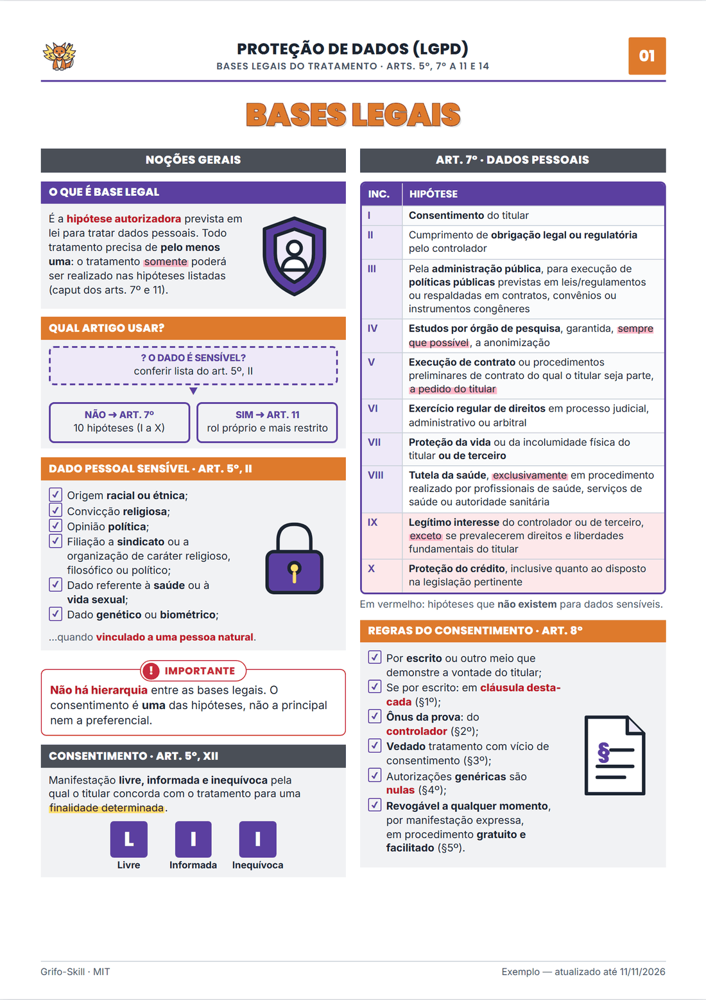

<p align="center">
  
</p>

<h1 align="center">Grifo-Skill: resumos e apostilas ilustradas para concursos públicos, feitos com IA</h1>

<p align="center">
  <b>Skill e plugin open source (MIT) para Claude que transforma qualquer tópico do edital em
  resumo esquematizado A4 — com faixas coloridas, ilustrações, fluxogramas, tabelas,
  lei seca grifada e questões inéditas no estilo da banca.</b>
</p>

<p align="center">
  <a href="LICENSE"></a>
  <a href="CHANGELOG.md"></a>
  <a href="https://github.com/asguth/grifo-skill/actions/workflows/ci.yml"></a>
  
  
  
</p>

<p align="center">
  
</p>

<p align="center">
  <a href="#instalação">Instalação</a> ·
  <a href="#comandos">Comandos</a> ·
  <a href="#exemplos-prontos">Exemplos</a> ·
  <a href="#galeria">Galeria</a> ·
  <a href="#como-funciona">Como funciona</a> ·
  <a href="#perguntas-frequentes">FAQ</a> ·
  <a href="CONTRIBUTING.md">Contribuir</a>
</p>

---

## O que é

O **Grifo-Skill** é uma *skill* de IA que monta **resumos para concurso público** no
padrão das apostilas esquematizadas impressas: folha A4, duas colunas, faixas de seção,
termos-chave grifados, personagens e ícones ilustrados, **mapas mentais**, fluxogramas,
pirâmides, **tabelas comparativas**, **lei seca grifada** e **questões inéditas** no
estilo de Cebraspe, FGV, FCC, Vunesp, Cesgranrio, IBFC e Quadrix. O resultado é um
**HTML autocontido e um PDF pronto para imprimir**.

Todo material passa por **três revisores automáticos** antes de chegar até você:

| Revisor | O que confere |
|---|---|
| 🔎 **Validador de conteúdo** | Cada artigo, prazo, número e gabarito contra a fonte oficial |
| 🎓 **Revisor didático** | Se dá para entender sozinho, se cobre o que cai e se a ordem faz sentido |
| 🎨 **Crítico de design** | Olha a página renderizada: layout, hierarquia, cores e ilustrações |

**Para quem é:** concurseiros de qualquer área (Direito, Português, Raciocínio Lógico,
TI, Administração, Contabilidade…), professores e cursinhos que querem material próprio,
e quem estuda por **revisão espaçada** com flashcards e folhas de véspera.

## Destaques da v1.1

- **Comandos com flags** (`--banca`, `--cargo`, `--folhas`, `--material`, `--disciplina`)
  e o novo **`/grifo`** de ajuda.
- **Novos componentes**: fórmula, **tabela-verdade**, bloco de **código** e **análise
  sintática** — além de Direito, agora atende bem RLM, TI e Português.
- **46 ilustrações próprias**, 12 novas (calculadora, gráfico, código, rede, globo…).
- **Tipografia de apostila**: nada de "(art. ⏎ 59)" ou "30 ⏎ dias" — espaço inseparável
  automático, hifenização em português e títulos equilibrados.
- **Revisão de layout automática**: estouro de página, transbordo de caixa, colunas
  desequilibradas, fonte < 8 pt e prévia em preto e branco.
- **PDF offline** com fontes embutidas. Lista completa no [CHANGELOG](CHANGELOG.md).

## Instalação

### Claude Code (plugin com os slash commands)
```
/plugin marketplace add asguth/grifo-skill
/plugin install grifo-skill@grifo-skill
```
Depois digite `/grifo` para ver todos os comandos. Para testar uma cópia local:
`claude --plugin-dir caminho/para/grifo-skill`.

### Claude.ai / app Claude (skill)
1. Baixe **`grifo-skill.zip`** na página de [Releases](https://github.com/asguth/grifo-skill/releases)
   (ou compacte a pasta `skills/grifo`).
2. No Claude, abra **Configurações → Capacidades → Skills** e faça upload do zip.
3. Peça: *"/resumo controle de constitucionalidade --banca fgv"* ou, em linguagem
   natural, *"faz um resumo de crase pra Vunesp"*.

> Para gerar o PDF e as imagens de revisão, o ambiente precisa executar código
> (Python + Playwright ou Chrome). Sem isso, a skill entrega o HTML, que você imprime
> pelo navegador (Ctrl+P → A4, sem margens, com gráficos de fundo).

### Outros modelos
`skills/grifo/SKILL.md` + `references/` funcionam como prompt de sistema em qualquer LLM
com execução de código. Os revisores ficam em `skills/grifo/agentes/`.

## Comandos

Sintaxe única para todos:
```
/<comando> <tópico> [--banca b] [--cargo "x"] [--folhas N] [--material arquivo] [--disciplina d-x]
```

| Comando | O que gera | Exemplo |
|---|---|---|
| `/resumo` | Resumo ilustrado completo (1–4 folhas) | `/resumo atos administrativos --banca fgv --folhas 2` |
| `/esquema` | Uma folha de mapa visual | `/esquema controle de constitucionalidade` |
| `/lei-seca` | Lei seca grifada (decorar × o que a banca troca) | `/lei-seca Lei 9.784/1999 --artigos 53-55` |
| `/comparar` | Tabela comparativa + como a banca confunde | `/comparar remoção vs redistribuição` |
| `/pegadinhas` | Armadilhas da banca, com correção e fundamento | `/pegadinhas licitações --banca fcc` |
| `/questoes` | Questões **inéditas** + gabarito comentado | `/questoes LGPD --banca cebraspe --n 20` |
| `/flashcards` | Cartões frente/verso para recortar (8 por folha) | `/flashcards LGPD` |
| `/mnemonico` | Siglas e frases para decorar | `/mnemonico requisitos do ato administrativo` |
| `/edital` | Edital verticalizado com checklist e prioridades | `/edital --material edital.pdf --cargo "Técnico"` |
| `/cronograma` | Plano semanal com revisões espaçadas | `/cronograma português, RLM --horas 20 --prova 15/03/2027` |
| `/revisao` | Uma folha de revisão de véspera | `/revisao processo administrativo` |
| `/apostila` | Capa + sumário + resumos + questões | `/apostila direito administrativo --banca fgv` |
| `/validar` | Roda os 3 revisores num HTML existente | `/validar minha-apostila.html` |
| `/grifo` | Ajuda: comandos, flags e exemplos | `/grifo questoes` |

- **Sem flags = padrões.** Banca padrão: `indefinida` (questões nos dois formatos, C/E e A–E).
- **Linguagem natural vale igual**: *"resumo de atos administrativos pra FGV, 2 folhas"*.
- **Material próprio**: anexe sua apostila, PDF ou anotações (`--material`) e ele vira a
  fonte principal.
- Conflito de nome com outro plugin no Claude Code? Use o namespace:
  `/grifo-skill:resumo`, `/grifo-skill:grifo`.

Especificação completa: [`references/comandos.md`](skills/grifo/references/comandos.md).

## Exemplos prontos

<p align="center">
  
</p>

| Material | Disciplina | Folhas | PDF | Prévia |
|---|---|---|---|---|
| LGPD — bases legais | Proteção de dados | 3 | [PDF](exemplos/lgpd-bases-legais.pdf) | [folha 1](docs/exemplos/lgpd-bases-legais-p1.png) · [2](docs/exemplos/lgpd-bases-legais-p2.png) · [3](docs/exemplos/lgpd-bases-legais-p3.png) |
| Lei 8.112/90 — servidores públicos federais | Dir. Administrativo | 4 | [PDF](exemplos/lei-8112-servidores.pdf) | [1](docs/exemplos/lei-8112-servidores-p1.png) · [2](docs/exemplos/lei-8112-servidores-p2.png) · [3](docs/exemplos/lei-8112-servidores-p3.png) · [4](docs/exemplos/lei-8112-servidores-p4.png) |
| Lei 9.784/99 — processo administrativo federal | Dir. Administrativo | 3 | [PDF](exemplos/lei-9784-processo-administrativo.pdf) | [1](docs/exemplos/lei-9784-processo-administrativo-p1.png) · [2](docs/exemplos/lei-9784-processo-administrativo-p2.png) · [3](docs/exemplos/lei-9784-processo-administrativo-p3.png) |
| **Novo:** Crase | Língua Portuguesa | 2 | [PDF](exemplos/portugues-crase.pdf) | [1](docs/exemplos/portugues-crase-p1.png) · [2](docs/exemplos/portugues-crase-p2.png) |
| **Novo:** Proposições e tabela-verdade | Raciocínio Lógico | 2 | [PDF](exemplos/rlm-proposicoes.pdf) | [1](docs/exemplos/rlm-proposicoes-p1.png) · [2](docs/exemplos/rlm-proposicoes-p2.png) |

<details>
<summary><b>Ver a folha 1 do exemplo de LGPD em tamanho real</b></summary>


</details>

## Galeria

**46 ilustrações próprias** (flat, contorno escuro, mudam de cor com a disciplina) — a
galeria é gerada automaticamente a partir da biblioteca:


<details>
<summary><b>Componentes do design system</b> (blocos, destaques, fórmula, tabela-verdade, código, análise sintática)</summary>


</details>

## Como funciona

```
pedido ─▶ fontes oficiais ─▶ roteiro didático ─▶ template + HTML (design system)
      ─▶ verificar.py ─▶ montar.py ─▶ renderizar.py (PDF + PNG + relatório)
      ─▶ 3 revisores em paralelo ─▶ correções ─▶ entrega
```

- **Design system "Grifo"** (`assets/grifo.css`): cores por disciplina e cores
  **semânticas fixas** (vermelho = pegadinha, laranja = exceção, verde = macete,
  cinza = lei seca, azul = exemplo). O aluno aprende o código uma vez e lê qualquer
  matéria. Contraste conferido por script.
- **Biblioteca de ilustrações** (`assets/ilustracoes.svg`) com o mascote **Grifo**.
- **Templates** (`assets/templates/`): o esqueleto de cada comando.

| Script | Faz |
|---|---|
| `verificar.py` | Lint do HTML-fonte: classes, ilustrações, numeração das folhas, `[VERIFICAR]` |
| `montar.py` | Injeta CSS + só as ilustrações usadas → HTML único; espaço inseparável; `--fontes-embutidas` |
| `renderizar.py` | PDF A4 + PNG por folha + relatório de layout (`--json`, `--pb`, `--estrito`) |
| `verificar_ilustracoes.py` | Valida a biblioteca (ids, viewBox, classes, paleta) |
| `verificar_contraste.py` | Texto branco ≥ 3:1 sobre as cores de todas as disciplinas |
| `galeria.py` | Regera a galeria a partir dos símbolos |

## Regras que a skill segue

- **Fidelidade acima de estética:** todo artigo, prazo e número vem da fonte oficial.
  O que não for conferido aparece marcado como `[VERIFICAR]`.
- **Sem cópia:** não reproduz texto, esquemas ou imagens de cursinhos, livros ou
  apostilas de terceiros, nem questões reais de prova. Lei e atos oficiais podem ser
  citados literalmente (Lei 9.610/98, art. 8º, IV).
- **Sem fotos de terceiros nem retratos de pessoas reais:** todas as ilustrações são próprias.
- **Legível em preto e branco:** todo bloco tem ícone e rótulo, não só cor.

> ⚠️ Material gerado por IA pode conter erros, mesmo depois da validação. Confira
> sempre a lei seca vigente antes da prova.

## Perguntas frequentes

**É de graça?** Sim. Código, ilustrações, mascote e exemplos são MIT. Você só precisa
de acesso ao Claude (Claude Code ou Claude.ai).

**Serve para qual banca?** Cebraspe, FGV, FCC, Vunesp, Cesgranrio, IBFC e Quadrix têm
perfil próprio; sem banca, as questões saem em certo/errado e múltipla escolha.

**Posso vender o material que gerar?** Pode — a licença MIT permite uso comercial.
Confira o conteúdo e não inclua material de terceiros.

**Funciona sem internet?** A geração usa o Claude; para o PDF sair idêntico offline,
monte com `montar.py --fontes-embutidas`.

**Só Direito?** Não: há cores, ilustrações e componentes para Português, Raciocínio
Lógico, TI, gestão, contabilidade e atualidades.

## Estrutura

```
.claude-plugin/        manifest do plugin e marketplace (Claude Code)
commands/              slash commands (/resumo, /questoes, /grifo, …)
skills/grifo/
  SKILL.md             fluxo principal
  references/          comandos, componentes, design, bancas, fidelidade
  agentes/             validador de conteúdo, revisor didático, crítico de design
  assets/              grifo.css, ilustracoes.svg, mascote/, fontes/ (OFL), templates/
  scripts/             verificar, montar, renderizar, galeria e testes
exemplos/              fonte, HTML e PDF de cada exemplo + galeria
docs/                  imagens do README, GIF e marca
ferramentas/           atualizar_docs.py (regera PDFs, PNGs e GIF do README)
.github/               CI e templates de issue
```

## Marca


O **Grifo** — o mascote do projeto — e o logo também são **MIT**, como o resto do
repositório: use em materiais gerados, apresentações e forks. Os arquivos ficam em
[`docs/marca/`](docs/marca) (logo, ícone, mascote e imagem de compartilhamento).
Só não use a marca para sugerir que um material é oficial do projeto quando não é.
<br clear="left">

## Contribuindo

PRs são bem-vindos — principalmente **novas ilustrações**, **perfis de banca** mais
precisos e **exemplos** revisados por quem passou na prova. Veja o
[CONTRIBUTING.md](CONTRIBUTING.md): rode os verificadores e anexe o PNG ao PR.

## Licença

[MIT](LICENSE) © 2026 Alberto Guth (GT Design). Use, modifique e distribua à vontade,
inclusive para fins comerciais, mantendo o aviso de copyright. As fontes Inter e Poppins
embutidas opcionalmente seguem a [SIL Open Font License](skills/grifo/assets/fontes/OFL.txt).
